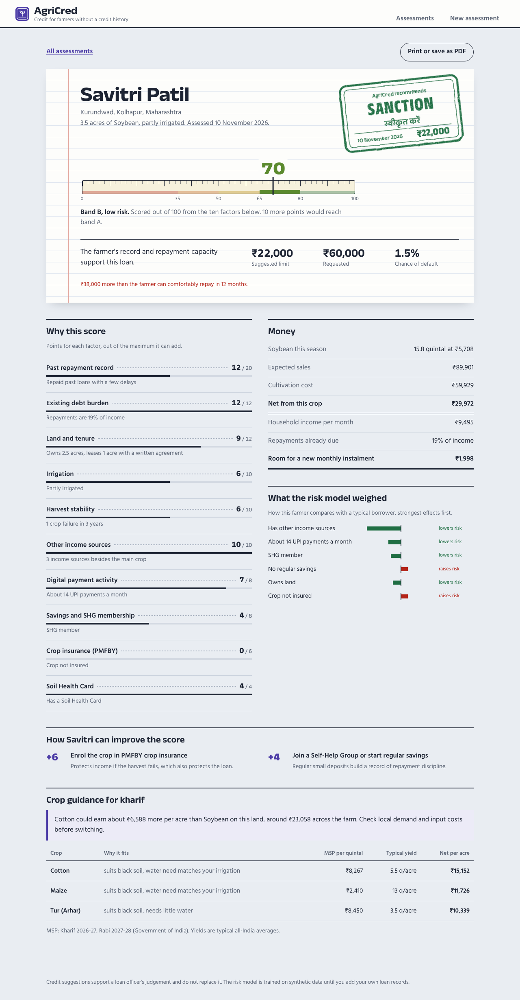
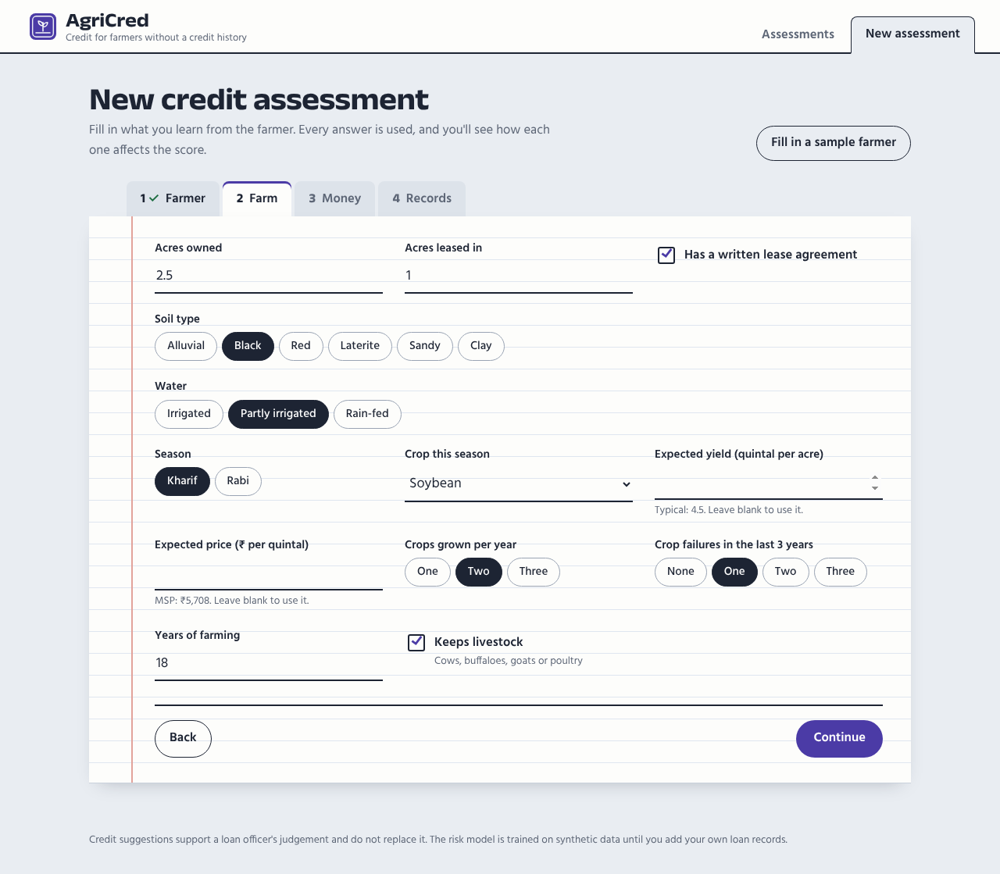
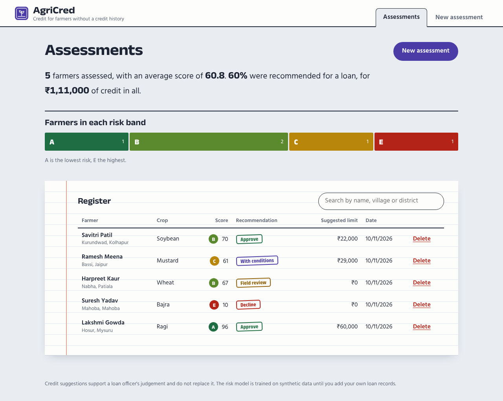

# AgriCred: Alternative Credit Evaluation for Farmers

Many smallholder farmers in India have no formal credit history, so banks and microfinance lenders struggle to judge them. **AgriCred** helps a loan officer assess a farmer using **alternative data**: land and tenure, irrigation, harvest history, livestock and other income, Self-Help Group (SHG) membership, savings, UPI payment activity, crop insurance and Soil Health Card status.

It gives an **explainable credit score**, a **probability of default**, a recommendation with a **suggested loan limit**, **crop guidance** based on current Minimum Support Prices (MSP), and **concrete steps** the farmer can take to improve.



## Features

- **Transparent scorecard (0–100):** ten factors, each with its points, its maximum and a plain-language reason, so a loan officer can explain the score to the farmer.
- **Risk model:** a logistic regression estimates the chance of default and shows which factors raise or lower it compared with a typical borrower.
- **Recommendation and limit:** Approve, Approve with conditions, Field review or Decline. The suggested limit is based on cultivation cost and capped by repayment capacity, so total loan repayments stay under 40% of household income.
- **Crop guidance:** ranks crops by fit with the farm's soil, season and water, then by expected net income per acre at MSP. It flags when switching crops could earn noticeably more.
- **Improvement plan:** for example, enrol in PMFBY (+6 points) or get a Soil Health Card (+4 points).
- **Portfolio dashboard:** totals, risk-band mix, approval rate, and search by name, village or district.
- **Print or save any assessment as a PDF.**

| New assessment | Dashboard |
|---|---|
|  |  |

## Tech stack

| Layer | Tech |
|---|---|
| Frontend | React 18, Vite |
| Backend | Python, Flask REST API |
| Database | MongoDB (pymongo) |
| Machine learning | scikit-learn (logistic regression), NumPy |
| Testing | pytest with an in-memory MongoDB (mongomock) |

## Setup

You need **Python 3.10+**, **Node.js 20.19+** and **MongoDB Community Server**.

**1. Install MongoDB**

Download **MongoDB Community Server** from mongodb.com/try/download/community and install it with the default options ("Install MongoD as a Service"). It then runs automatically on `localhost:27017`.

**2. Backend**

```bash
cd backend
python -m venv venv
venv\Scripts\activate        # Windows  (macOS/Linux: source venv/bin/activate)
pip install -r requirements.txt
python app.py                # http://localhost:5000
```

The risk model trains automatically on first start (a few seconds).

**3. Frontend** (in a second terminal)

```bash
cd frontend
npm install
npm run dev                  # http://localhost:5173
```

On Windows, after the first setup you can double-click **`start.bat`**. To try the app without installing MongoDB, set `MONGO_URI=mongomock://` before `python app.py`. Data is then kept in memory only.

## How the score works

| Factor | Max points |
|---|---|
| Past repayment record (no history counts as neutral) | 20 |
| Existing debt burden (repayments as a share of income) | 12 |
| Land and tenure (owned acres, written lease) | 12 |
| Irrigation | 10 |
| Harvest stability (crop failures in 3 years) | 10 |
| Other income sources (livestock, other income, more earners) | 10 |
| Digital payment activity (UPI) | 8 |
| Savings and SHG membership | 8 |
| Crop insurance (PMFBY) | 6 |
| Soil Health Card | 4 |

Bands: **A** 80+, **B** 65–79, **C** 50–64, **D** 35–49, **E** below 35. The recommendation combines the band with the model's probability of default, and a farmer with a good score but no repayment capacity is referred for review instead of being approved.

## More detail

- [How the score, the decision and the loan limit work](docs/scoring.md), with a worked example
- [The default-risk model](docs/risk-model.md)
- [Crop data and guidance](docs/crop-data.md)
- [API reference](docs/api.md)

## Data sources and honesty notes

- **Crop prices** are the Government of India's MSPs for Kharif 2026-27 and Rabi 2027-28. **Costs** are CACP cost of production (A2+FL) where published. **Yields** are typical all-India averages and vary widely by district, so the form lets you enter local yield and price. Update `backend/agricred/crops.py` each season.
- **The risk model is trained on synthetic data.** There is no public dataset of Indian smallholder loan outcomes, so `risk_model.py` generates labelled synthetic farmers with plausible relationships plus noise. It demonstrates the method, not real-world accuracy. A lender should retrain it on their own loan history before relying on it.
- The tool supports a loan officer's judgement. It isn't a lending policy.

## API

| Method | Endpoint | Description |
|---|---|---|
| GET | `/api/health` | MongoDB connection status |
| GET | `/api/crops` | Crop catalogue with MSP and typical yields |
| POST | `/api/assessments` | Assess and save a farmer (`?save=0` to preview without saving) |
| GET | `/api/assessments?q=` | List or search assessments |
| GET | `/api/assessments/<id>` | One assessment |
| DELETE | `/api/assessments/<id>` | Delete an assessment |
| GET | `/api/stats` | Portfolio statistics |

## Tests

```bash
cd backend
pytest -q
```

29 tests, one file per module (`test_scorecard.py`, `test_assessment.py`, `test_risk_model.py`, `test_crops.py`, `test_api.py`), use an in-memory MongoDB, so no database is needed.

## Author

**Yashas Raj R**: [GitHub](https://github.com/YashasRajR)
